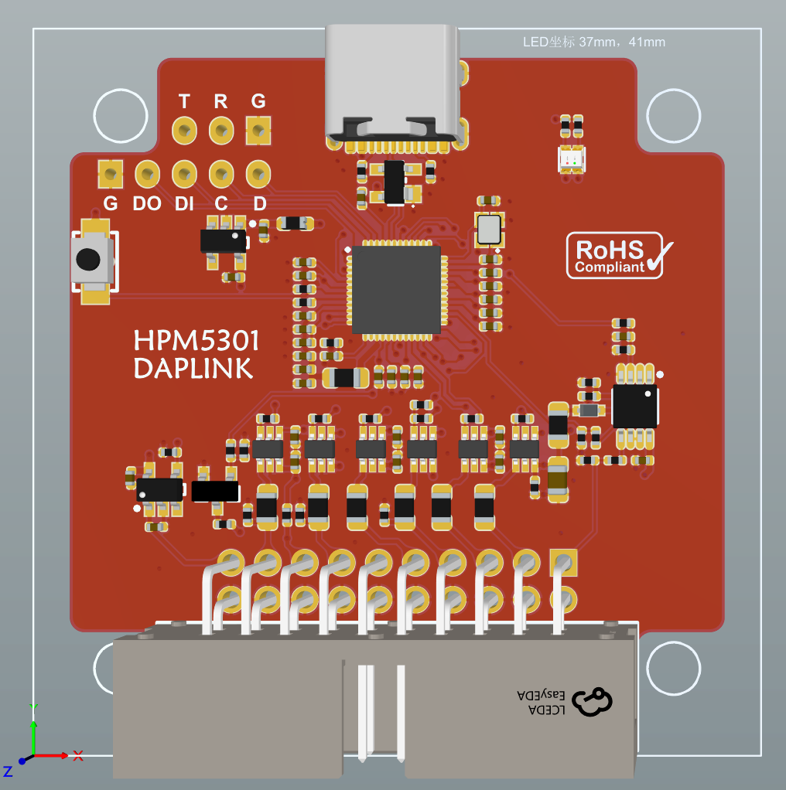
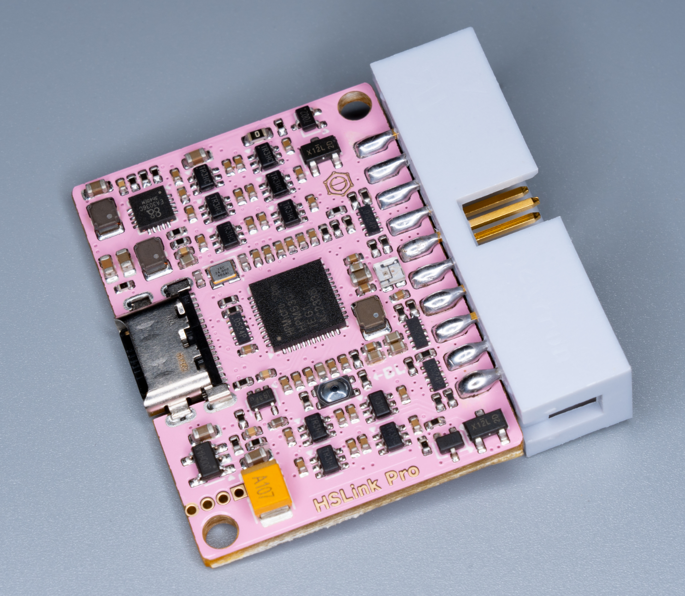
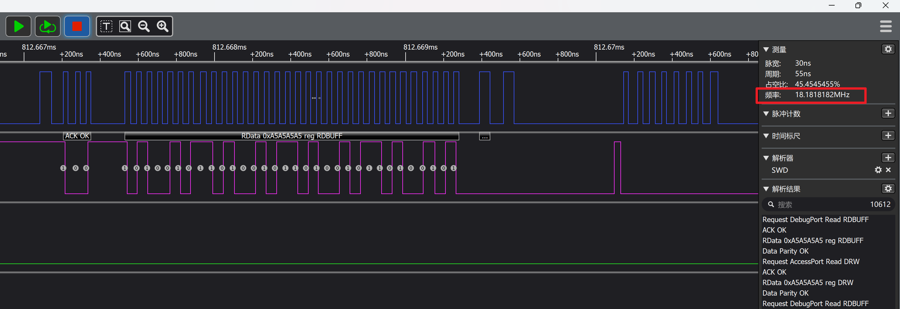
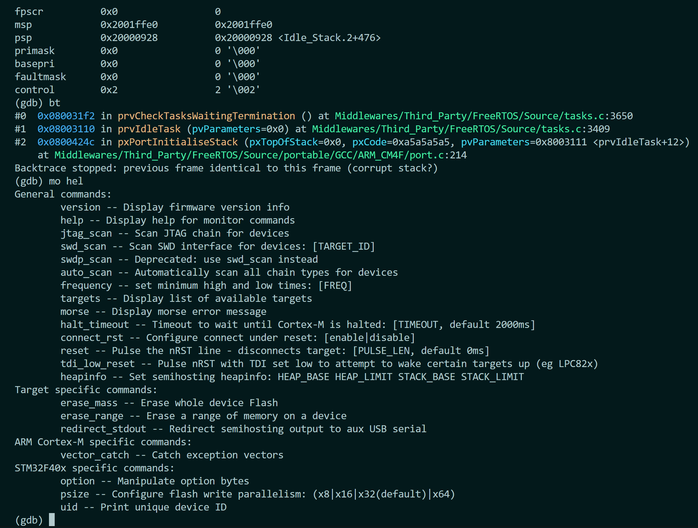

# bmp-hpm-port

A [Black Magic Debug](https://black-magic.org/) port for HPMicro RISC-V MCUs. It turns an HSLink Lite / HSLink Pro (HPM5301) board into a standalone debug probe with a built-in GDB server.

> 中文说明见 [README_zh.md](./README_zh.md)。Build instructions: [README_build.md](./README_build.md) (English) / [README_build_zh.md](./README_build_zh.md) (中文).

---

## Supported Hardware

- HSLink Lite (HPM5301)

  

- HSLink Pro (HPM5301)

  

---

## How to Build

This project requires **HPM SDK 1.13** and a `riscv-none-elf` cross-compilation toolchain. Compiler and SDK paths are taken from environment variables; nothing is hard-coded in `CMakePresets.json`.

See **[README_build.md](./README_build.md)** / **[README_build_zh.md](./README_build_zh.md)** for the full guide:

```bash
export PATH="<toolchain>/bin:$PATH"
export HPM_SDK_BASE="<hpm_sdk root>"
export GNURISCV_TOOLCHAIN_PATH="<toolchain root>"

cmake --list-presets
cmake --preset hslinklite-xip-release
cmake --build --preset hslinklite-xip-release
```

---

## Performance

### SWD waveforms

Porting BMP to the HPM platform lets the FGPIO and SPI peripherals drive the SWD/JTAG clock. The debug clock is therefore much faster than plain bit-banging, which improves debugging efficiency.

- FGPIO mode: SWD clock up to `18 MHz` currently.

  

- SPI mode: work in progress, target SWD clock up to `80 MHz`.

### Command-line debug demo

Driving BMP directly with GDB commands gives a more flexible and efficient debugging experience than an IDE.



---

## Using Black Magic Probe

- `xxx-gdb yyy.elf`: start GDB and load the ELF file
- `target extended-remote //./COMx`: connect to the GDB server (`COMx` is the serial port)
- `monitor jtag_scan`: scan for devices over JTAG
- `monitor swd_scan`: scan for devices over SWD
- `monitor auto_scan`: automatic scan
- `attach 1`: attach to target No. 1
- `load`: program the ELF into the target

### Example session

```gdb
(gdb) target extended-remote //./COM8
Remote debugging using //./COM8
(gdb) monitor help
(gdb) monitor jtag_scan
Target voltage: Unknown
Available Targets:
No. Att Driver
 1      STM32F40x M4
(gdb) attach 1
(gdb) load
Loading section .isr_vector, size 0x188 lma 0x8000000
Loading section .text, size 0x4898 lma 0x8000190
Loading section .rodata, size 0x60 lma 0x8004a28
Loading section .ARM, size 0x8 lma 0x8004a88
Loading section .init_array, size 0x4 lma 0x8004a90
Loading section .fini_array, size 0x4 lma 0x8004a94
Loading section .data, size 0x10 lma 0x8004a98
Start address 0x0800468c, load size 19104
Transfer rate: 32 KB/sec, 764 bytes/write.
(gdb)
```

### Other useful GDB commands

- `monitor <cmd>`: send a monitor command to the remote target (depends on the server implementation)
- `commands <index>`: define a breakpoint script
- `break *<address>`: set a breakpoint at a specific address
- `print sizeof(xxxx)`: show the size of a variable
- `dprintf main.c:122,"hello\n"`: dynamic printf
- `tbreak main`: set a temporary breakpoint
- `set print pretty on`: pretty-print structures
- `run` / `r`: start execution
- `continue` / `c`: continue execution
- `backtrace` / `bt`: show the call stack
- `set var <var>=<value>`: modify a variable
- `disassemble /s <address>`: disassemble with source
- `info locals`: show local variables
- `info target`: show the program memory layout
- `info registers`: show registers
- `find /w 0x08000000,+0x1000,0xdeadbeef`: search a memory range for a value

### HPMicro XPI flash support

This project is developed on the HPM platform and prioritizes XPI-FLASH debugging for HPM chips. The flash download algorithm comes from the official OpenOCD repository. It applies to all HPM chips and has been verified on the HPM5300 and HPM6800 series; other series can be verified by users.

After attaching to an HPM chip, use `xpi_cfg` to pass configuration parameters to `rom_api` for the download algorithm. If `xpi_cfg` is not executed, default parameters are used. `xpi_info` prints the current configuration.

Command format:

```bash
xpi_cfg -- <flash_base> <flash_size> <xpi_base> [opt0] [opt1]
```

Example for the HPM5300 series:

```bash
monitor xpi_cfg 0x80000000 0x2000000 0xf3000000 0x6 0x1000
```

For other series, refer to the official OpenOCD configuration files.

---

## Cortex-Debug configuration

For users who prefer not to operate GDB from the command line, the Cortex-Debug VS Code extension provides good support for BMP.

SWD launch configuration example:

```json
{
    "name": "bmp-launch-swd",
    "cwd": "${workspaceFolder}",
    "executable": "./build/LED_TEST_F407ZE.elf",
    "request": "launch",
    "type": "cortex-debug",
    "runToEntryPoint": "main",
    "servertype": "bmp",
    "device": "STM32F407ZE",
    "BMPGDBSerialPort": "//./COM8",
    "interface": "swd",
    "gdbPath": "C:/Develop_Software/gdb-multiarch-14.1/bin/gdb-multiarch.exe",
}
```

JTAG launch configuration example:

```json
{
    "name": "bmp-launch-swd",
    "cwd": "${workspaceFolder}",
    "executable": "./build/LED_TEST_F407ZE.elf",
    "request": "launch",
    "type": "cortex-debug",
    "runToEntryPoint": "main",
    "servertype": "bmp",
    "device": "STM32F407ZE",
    "BMPGDBSerialPort": "//./COM8",
    "interface": "jtag",
    "gdbPath": "C:/Develop_Software/gdb-multiarch-14.1/bin/gdb-multiarch.exe",
}
```

### Cortex-Debug on the HPM platform

For a `launch` request, Cortex-Debug writes ARM CoreSight registers by default to perform a soft reset, which is not compatible with HPM's RISC-V implementation. Cortex-Debug provides `overrideResetCommands` and `overrideLaunchCommands` for custom reset sequences. The example below rewrites the launch commands into a combination of flash configuration and `load`, achieving the same effect as on ARM:

```json
{
    "name": "bmp-launch",
    "cwd": "${workspaceFolder}",
    "executable": "build/output/demo.elf",
    "request": "launch",
    "type": "cortex-debug",
    "runToEntryPoint": "main",
    "overrideResetCommands": [],
    "overrideLaunchCommands": [
        "monitor xpi_cfg 0x80000000 0x2000000 0xf3000000 0x6 0x1000",
        "load"
    ],
    "servertype": "bmp",
    "interface": "jtag",
    "BMPGDBSerialPort": "//./COM8",
    "gdbPath": "C:/Develop_Software/gdb-multiarch-14.1/bin/gdb-multiarch.exe",
    "svdFile":"${config:hpm_sdk_env}/hpm_sdk/soc/HPM5300/HPM5301/HPM5301_svd.xml",
}
```

---

## References

- [HPMicro: hpm_sdk development with VS Code](https://www.hpmicro.com/service-support/technical-articles/168)
- [CherryDAP](https://github.com/cherry-embedded/CherryDAP)
- [MicroLink](https://github.com/Aladdin-Wang/MicroLink)
- [Black Magic Debug](https://black-magic.org/index.html)
- [GDB documentation](https://sourceware.org/gdb/documentation/)
